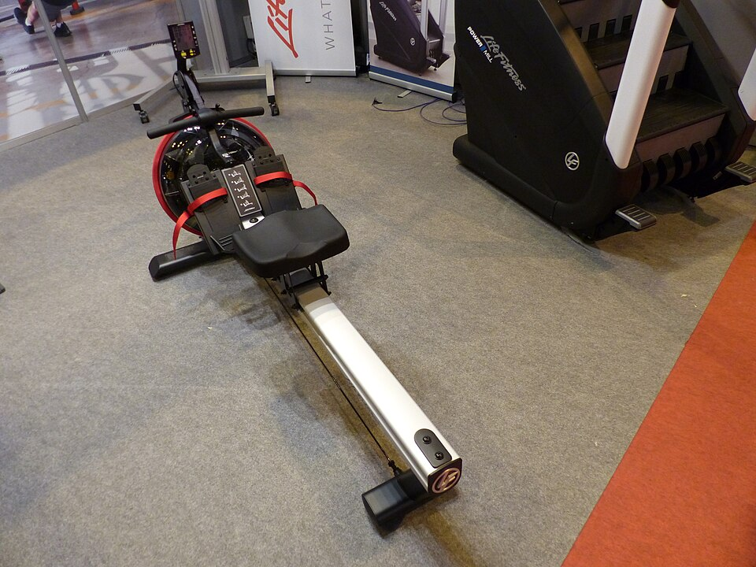
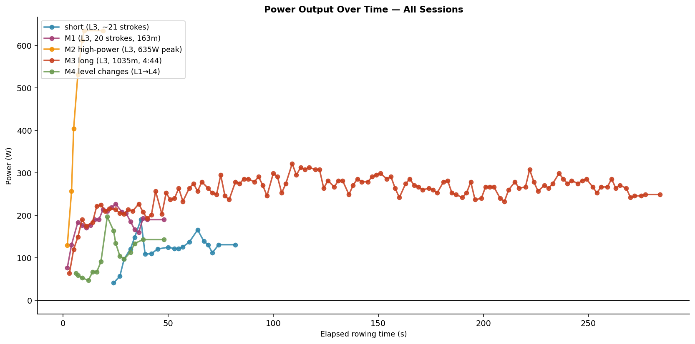

**Your rowing machine, your data, your house.**

splits turns a water rower into a live training display on any phone,
tablet or laptop in the room, and keeps every stroke you've ever pulled.
It's a self-hosted PWA, so there's no app store, no sign-up and no cloud.

  
   
  Life Fitness Row GX Trainer. Photo: Benjamín Núñez González,
  <a href="https://commons.wikimedia.org/wiki/File:Life_Fitness,_waterrower,_Spain,_2016.JPG">Wikimedia Commons</a>,
  <a href="https://creativecommons.org/licenses/by-sa/4.0/">CC BY-SA 4.0</a>

## Why

The Row GX ships with a console that shows numbers for the current workout
and then forgets them. The vendor's companion software, FirstCoach, runs
only on Windows. splits reads the console's USB port directly and gives you:

- **Live numbers on your phone.** Split, stroke rate, watts and distance
  update stroke by stroke while you row.
- **A history that stays.** Every session is stored and broken down per
  rower, so you can see trends over weeks and months.
- **Goals** (next up, [M5](ROADMAP.md)). Set a target and see how you're
  tracking against it.

## Privacy by design

splits runs on a small box in your home, behind your home router's
firewall. Your workouts never leave your network.

- **No cloud, ever.** Cloud sync isn't on the roadmap.
- **No telemetry**, no third-party calls and no CDNs at runtime.
- **Works offline.** The installed PWA keeps your stats readable in
  airplane mode.

## Hardware

| Part | What it is | Official specs |
|------|------------|----------------|
| **Ergometer** | Life Fitness Row GX Trainer: water ("Fluid Technology") resistance, 16 levels, 150 kg max user | [Life Fitness spec sheet (PDF)](https://www.lifefitness.com.au/wp-content/uploads/2016/01/PM-024-15-ROW-GX-Sell-Sheet-vf.pdf) |
| **Console** | First Degree Fitness IPM (the Row GX is FDF-built), micro-USB on the underside | [First Degree Fitness](https://www.firstdegreefitness.com/) |
| **USB bridge** | FTDI FT232R USB-to-serial chip, `0403:6001`, 9600 baud 8N1 | [FTDI FT232R](https://ftdichip.com/products/ft232rl/) |
| **Host** | Raspberry Pi Zero 2 W or any Pi 3/4/5, x86-64 Linux box, Mac or Windows PC | [Raspberry Pi Zero 2 W](https://www.raspberrypi.com/products/raspberry-pi-zero-2-w/) |

The console's serial protocol isn't published, so we reverse-engineered
it from captured sessions. The handshake and the live `A8` stroke stream
are fully decoded in
[INT-0001](specs/int/0001-ipm-serial-protocol.md).

  
   
  Power curves decoded from real captures. More charts are in <a href="docs/visualizations/">docs/visualizations/</a>.

## Install

1. Download the tarball for your board from
   [Releases](https://github.com/dgloeckner/splits/releases). `v*` tags
   are stable releases and `nightly` tracks `main`.
2. Plug the rower's console into the host via USB.
3. Follow [`deploy/README.md`](deploy/README.md).

Each tarball bundles a static Go binary, the PWA and a systemd installer.

## Goals (v1)

- Real-time live display during workouts via PWA
- Multi-user with simple auth
- Indefinite session history with per-user statistics
- Training goals
- Installable without an app store
- Runs on Mac, Windows, or a Raspberry Pi

## Non-goals (v1)

- Cloud sync
- Public leaderboards / social features

## Under the hood

Go backend and React (Vite, TS) frontend, shipped as a single embedded
binary ([ADR-0003](specs/adr/0003-tech-stack-go-react.md)).

- 🤖 [`AGENTS.md`](AGENTS.md): start here as a contributor, human or AI
- 🗺️ [`ROADMAP.md`](ROADMAP.md): milestones
- 📋 [`specs/`](specs/): FEAT / INT / ADR specifications
- 📖 [`docs/domain-glossary.md`](docs/domain-glossary.md): rowing vocabulary
- 🧪 [`traces/`](traces/): probe scripts and the Python reference parser

## License

Apache License 2.0, see [`LICENSE`](LICENSE). The Row GX photo is
CC BY-SA 4.0 (credit above).
