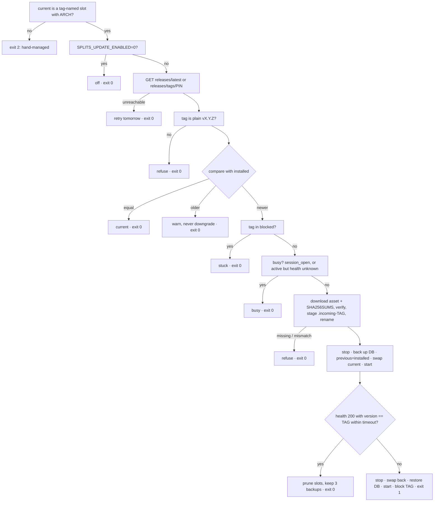

# ADR-0023: Unattended OTA Updates for the Pi

- **Status**: Accepted
- **Date**: 2026-10-18
- **Relates to**: [ADR-0001](0001-deployment-targets.md) (Deployment Targets), [ADR-0004](0004-local-first-persistence.md) (Local-First Persistence), [ADR-0021](0021-local-first-boot.md) (Local-first boot), [ADR-0022](0022-ci-and-release-packaging.md) (CI and Release Packaging)
- **Feature**: [FEAT-0016](../feat/0016-unattended-updates.md)
- **Issue**: [#22](https://github.com/dgloeckner/splits/issues/22)

## Context

ADR-0022 made every `vX.Y.Z` tag a GitHub Release carrying
`splits-linux-<armv6|armv7|arm64|amd64>-<tag>.tar.gz` plus `SHA256SUMS`,
and a rolling `nightly` pre-release from `main`. Getting one of those onto
a Pi is still a person's job: download, `sha256sum -c`, unpack, run
`deploy/install.sh` as root. Nothing on the Pi records which version is
installed, nothing keeps the previous binary, nothing checks health after
an upgrade, and `systemctl enable --now` does not restart a running
service, so the old process keeps serving until somebody notices.

In a household the Pi sits behind the Ergo and nobody is at the keyboard.
**An upgrade that can leave it needing a human has failed.** The
requirement: the Pi installs new releases on its own, atomically, and
rolls back on its own when the new version does not come up healthy.

`dgloeckner/clubbar` solved the same problem for its till terminals
([clubbar ADR-0054](https://github.com/dgloeckner/clubbar/blob/main/adr/0054-terminal-runs-its-backends-version.md)):
a nightly systemd timer, A/B release slots under a `current` symlink, a
SHA-256-verified tarball from GitHub Releases, a database backup before
the swap, a bounded health window, unconditional rollback, a `blocked`
list only a human clears, and every refusal "no update, exit 0". This ADR
adopts that pattern with one structural difference: clubbar's terminal
follows *its backend's* version, because the two are released separately
and their sync contract is unversioned. splits has no second component to
follow — backend and PWA ship in **one tarball**, so the pair is tested by
construction. The Pi follows the repository's latest non-pre-release
GitHub Release instead. Publishing a Release is the single act that moves
every Pi.

## Options considered

### Option A — Nightly root timer, A/B slots, follow `releases/latest` (chosen)

A shell updater shipped inside every bundle, run by a system timer at
04:30 (after the 03:30 backup). It asks GitHub for the latest
non-pre-release Release, refuses unless every precondition holds, stages
the new bundle into its own slot, backs up the database with the service
stopped, swaps one symlink, and accepts the result only when
`/api/health` reports the new tag within a bounded window. Anything else
rolls back and blocks the tag. Detailed in *Decision*.

Pros: no new infrastructure, no daemon, no dependencies beyond what Pi
OS ships (`curl`, `tar`, `sha256sum`, `systemctl`); the same pattern is
proven in clubbar; one rename(2) is the whole switch, so every reader
sees either the old version or the new one. Cons: GitHub is in the update
path; a release that changes a systemd unit or the Caddyfile still needs
`install.sh` by hand (see *Consequences*).

### Option B — Follow `releases/latest` including pre-releases

Pros: `-rc` tags reach real hardware without a person. Cons: a household
Pi is not a test bench, and an `-rc` is by definition a build the
maintainer has not yet vouched for. `nightly` is worse: it is replaced on
every merge, so "installed `nightly`" names no build at all. Rejected; a
person who wants an `-rc` installs it with `install.sh`, which makes the
slot hand-managed (below) and opts that Pi out of the updater.

### Option C — Pinned tag only

Every Pi updates only when told which tag to hold. Pros: nothing moves
without a decision. Cons: that decision is the per-Pi human act this ADR
exists to remove. Kept as a *knob*, not the default: `SPLITS_UPDATE_PIN`
holds one Pi at one tag.

### Option D — In-process self-update in Go

The backend downloads its successor and re-execs. Rejected for the reason
clubbar ADR-0054 rejects an in-app updater: the process deciding whether
an update worked must not be the one being updated. A binary that fails
to start cannot roll itself back, and `ProtectSystem=strict` (correctly)
keeps the service from writing its own install directory.

### Option E — apt repository / RAUC / Mender

Pros: industrial-grade A/B images, signed metadata. Cons: an apt repo
needs hosting and key management; RAUC/Mender want a partition layout and
an image build pipeline. Infrastructure far above a single static binary
plus a static web bundle on a household Pi.

## Decision

**Option A.** Specifically:

### 1. Versioning and stamping

- The version **is** the git tag `vMAJOR.MINOR.PATCH` (ADR-0022). A tag
  with a `-suffix` is published as a pre-release and **never
  auto-installed**; neither is `nightly`.
- `release.yml` refuses a tag that does not match
  `^v[0-9]+\.[0-9]+\.[0-9]+(-[0-9A-Za-z.]+)?$`. (clubbar shipped `1.1.7`
  without the `v`; every updater refused it and nothing in CI had
  checked.)
- `deploy/build.sh` stamps `-X main.version=$VERSION -X
  main.commit=$SHA`; `splits --version` prints both; an unstamped build
  reports `dev`.
- `GET /api/health` returns
  `{"status":"ok","version":"v0.4.1","commit":"abc1234","session_open":false}`.
  It is ungated, `NetworkOnly` in the service worker and already the
  PWA's reachability probe (ADR-0020), so the fields add no traffic.
  `session_open` comes from the sessionizer snapshot that
  `/api/v1/session/active` already reads.
- The web build defines `__BUILD_VERSION__` (env `VERSION`, set by
  `bundle.sh` and by `release.yml`'s web job; fallback `git describe
  --tags --always`). The Profil footer reads `splits v0.4.1 · Build abc1234`.
- `bundle.sh` writes an `ARCH` file (`linux-armv7`, …) beside `VERSION`.
  The updater reads `ARCH` to pick its asset. It **never** reads
  `VERSION`: the `current` symlink is the only source of truth for what is
  installed. A second copy can contradict the directory it sits in, and
  the contradiction would be silent.

### 2. Host layout — A/B slots

```
/opt/splits/
  releases/v0.4.0/          bin/splits  web/dist/  deploy/  VERSION  ARCH
  releases/v0.4.1/
  current  -> releases/v0.4.1     swapped atomically (ln -sfn temp, mv -Tf)
  previous -> releases/v0.4.0     the rollback target
  blocked                         one tag per line; cleared only by a human
  update-state.json               the last run's verdict
/usr/local/bin/splits -> /opt/splits/current/bin/splits
/var/www/splits       -> /opt/splits/current/web/dist
/var/lib/splits/update-backup/splits-<oldtag>-<ts>.db     newest 3 kept
```

- `install.sh` installs **the bundle it sits in** as a slot named after
  line 1 of its `VERSION`, points `current` at it, creates both
  symlinks, and installs and enables `splits-update.timer`. `BIN=` and
  `WEB_DIST=` are dropped; the from-source path is `bundle.sh` → tarball.
- A flat install (a regular file at `/usr/local/bin/splits`, a real
  directory at `/var/www/splits`) is migrated by replacing both with the
  symlinks. `splits.env`, the database and the rendered Caddyfile are left
  as they are.
- A slot not named after a release tag (`dev`, `nightly`, a `git
  describe` string) is a **hand-managed install**: the updater exits 2 and
  `--status` says so. Fail-closed: an unknown version is not an infinite
  ceiling.

### 3. The updater

`deploy/splits-update.sh`, run by `splits-update.service` (system unit,
root, `Type=oneshot`, `TimeoutStartSec=1800`, `Restart=no`) from
`splits-update.timer` (`OnCalendar=*-*-* 04:30:00`,
`RandomizedDelaySec=3600`, `Persistent=true`). The unit runs
`/opt/splits/current/deploy/splits-update.sh`, so each release brings its
own updater. Root, because it restarts `splits.service` and writes
`/opt/splits` and the backup directory — none of which the hardened
service may touch.

Modes: run (the timer), `--check` (decide, change nothing), `--status`,
`--clear-block`. Config in `/etc/splits/splits.env`:
`SPLITS_UPDATE_ENABLED` (default `1`), `SPLITS_UPDATE_PIN`,
`SPLITS_UPDATE_REPO` (default `dgloeckner/splits`),
`SPLITS_UPDATE_HEALTH_TIMEOUT` (default `120`). The cadence is **not** a
config key; anything else is a systemd drop-in, because the 04:30 window
is what makes restoring the pre-update database safe (§3 step 10).

Decision order. Every refusal logs its reason, writes
`update-state.json`, and **exits 0** — "no update, retry tomorrow" is not
an error.



1. `current` is not a symlink to a tag-named slot, or the slot has no
   `ARCH` → exit **2**, nothing changed.
2. `SPLITS_UPDATE_ENABLED=0` → done.
3. `GET https://api.github.com/repos/$REPO/releases/latest` (with a pin:
   `releases/tags/$PIN`), `curl --retry 3`. Unreachable → tomorrow.
   `tag_name` must be a plain `vX.Y.Z`; anything else → refuse.
4. Equal to installed → nothing to do. **Older → warn, never
   downgrade**: migrations in `storage.Open` are forward-only and the
   backup that would make a downgrade safe is long gone.
5. Tag listed in `blocked` → refuse.
6. Busy check via `GET http://127.0.0.1:8080/api/health`:
   `session_open: true` → refuse (somebody is rowing; the DB is live).
   Service `inactive`/`failed` per `systemctl is-active` → nothing can be
   writing, treat as idle — this is also how a crashed backend gets fixed
   over the air. Service active but health not answering → "unknown is
   not idle", refuse.
7. Download `splits-linux-$ARCH-$TAG.tar.gz` and `SHA256SUMS` from
   `releases/download/$TAG/`, `sha256sum -c --ignore-missing`. No asset
   for this arch, no sum line, or a mismatch → refuse (TLS authenticates
   the host; the checksum catches a truncated download). Extract into
   `releases/.incoming-$TAG`, require an executable `bin/splits` and
   `web/dist/index.html`, then rename to `releases/$TAG`. A power loss
   never leaves a half-filled slot named after a tag.
8. `systemctl stop splits`, copy `splits.db` (plus `-wal`/`-shm`) to
   `update-backup/`, repoint `previous`, swap `current`, `systemctl start
   splits`.
9. Health window: within `SPLITS_UPDATE_HEALTH_TIMEOUT`, `/api/health`
   answers 200 **with `version == $TAG`**. Equality is the test — it
   proves the new binary is the one serving, not a stale process. Success
   → prune slots other than `current`/`previous`, keep three backups,
   exit 0.
10. Failure → stop, swap `current` back, restore the DB copy, start,
    append the tag to `blocked`, remove the failed slot, exit **1**. If
    the old version does not come up either, log CRITICAL and still exit
    1. Unlike clubbar's amendment there is no "was the backend reachable"
    conditional: health is local here, so a missing answer *is* a verdict
    on the build. The rollback restores the pre-update copy, so a
    migration the failed version applied is undone with it; the 04:30
    window and the `session_open` refusal are what make that safe.

The updater needs only `curl`, `tar`, `sha256sum`, `systemctl`; JSON is
read with `sed`/`grep` (no `jq` on stock Pi OS). `set -uo pipefail`, no
`set -e`: every branch must reach its log line and the state file.

### 4. Reporting

- `update-state.json` is written on every run, `--check` included:

  ```json
  {
    "checked_at": "2026-10-19T04:41:07Z",
    "installed": "v0.4.1",
    "latest": "v0.4.2",
    "state": "behind",
    "result": "busy",
    "message": "a session is open; no update tonight",
    "blocked": ["v0.4.0"]
  }
  ```

- Five states: **current** · **behind** (a Release is out, tonight's run
  will take it — the normal state of every Pi between a Release and
  04:30, *not an alarm*) · **stuck** (the latest Release failed here and
  was rolled back) · **unknown** (hand-managed, or no state file yet) ·
  **off**. `state` is the summary, `result` what the last run did
  (`updated`, `rolled-back`, `busy`, `unreachable`, …).
- The **updater** writes `state`. It is the one place that compares two
  tags; a second comparator in Go that disagreed with the shell one is
  how a Pi ends up reporting "current" while it is behind. When the
  GitHub lookup fails, the previous run's `latest` is carried over.
- `GET /api/v1/update-status` (gated like every v1 route) reads the file
  from `SPLITS_UPDATE_STATE` (default `/opt/splits/update-state.json`)
  and passes it through with `available: true`; a `state` outside the
  five, or tags that are not plain release tags, read as `unknown`.
  Absent file → `{"available": false, "state": "unknown"}`.
- The Profil page renders them in an "Updates" block. *Behind* and
  *stuck* must not look alike.

### 5. PWA reload policy

- Today `registerType: 'autoUpdate'` activates a new service worker as
  soon as it installs and reloads the page — after an unattended 04:30
  deploy that can be a phone left open on the Live view, mid-session.
- Decision: `registerType: 'prompt'`. The new worker still *installs*
  immediately, so its precache warms at home and ADR-0021's promise that
  the deploy lands before the away-from-home launch holds. Activation
  waits. `onNeedRefresh` shows the toast „Neue Version verfügbar — Neu
  laden", **except while a session is open or the Live view is mounted**,
  where the offer is deferred to the next navigation to Home or Verlauf.
  Closing every tab applies the update on the next launch regardless.
- `clientsClaim` stays on (`prompt` would drop it with `skipWaiting`):
  on the very first install there is no old worker to wait for, and an
  unclaimed page would not route the offline pack through the SW cache
  until a reload. It only acts on activation, so it never forces an
  update on an open page.
- The SSE stream (`/api/v1/stream`) is no longer routed through the SW
  (no route, no `respondWith`). An open-ended fetch the active worker is
  answering keeps a waiting worker from ever activating, and the stream
  is open on every page — so „Neu laden" would never have applied an
  update while the app was open. Found by the stage-5 Playwright spec.
  The route was `NetworkOnly` before, so nothing about caching changes.
- The registration also checks for a new worker hourly, so a phone that
  stays open across the 04:30 deploy still learns about it.
- `PERSIST_BUSTER` stays schema-based (ADR-0021 §7): a release does not
  drop the Rucksack.

## Consequences

- **Publishing a Release is a deploy.** Every Pi with updates on takes a
  `vX.Y.Z` Release within a day. Tag only what you would install
  yourself; use `-rc` tags for anything else.
- **GitHub is called once a night.** AGENTS.md rule 7 ("no external API
  calls at runtime") concerns the app: the backend and the PWA still make
  none. The updater is a separate root timer, it sends nothing but the
  request for the release, and `SPLITS_UPDATE_ENABLED=0` turns it off.
- **A blocked Pi stays blocked.** After a rollback the Pi does nothing
  until a *newer* Release exists or a person runs `--clear-block`. That is
  why §4 is not optional: a stuck Pi must be visible from the phone.
- **Units and the Caddyfile are out of reach.** The updater does not touch
  systemd units or the Caddyfile (which carries the DuckDNS token and is
  rendered by `install.sh` only). `splits.service` keeps
  `ExecStart=/usr/local/bin/splits`, so a binary change needs no unit
  change. A release that changes a unit, the Caddyfile or the env
  template says so in its notes and is applied with `install.sh` from
  that release's tarball.
- **The bundle carries its own updater.** A bug in `splits-update.sh` is
  fixed by the next release that the buggy one manages to install; one
  that cannot install anything needs `install.sh` once.
- **The service worker no longer reloads pages by itself.** A user who
  never taps „Neu laden" and never closes the app keeps the old shell
  until they do; the backend is forward-compatible within a release line,
  so that is a stale UI, not a broken one.
- **Downgrades are manual.** Restoring an older version means stopping
  the service, restoring a backup from `update-backup/` or `backups/`, and
  running that version's `install.sh` — documented in `deploy/README.md`.
- Out of scope: auto-installing `nightly` or `-rc` tags, a web "update
  now" button, updating Caddy/the OS/systemd units, signing beyond TLS +
  SHA-256 (minisign stays an open question, as in clubbar), Docker / Mac /
  Windows packages (deferred by ADR-0022).
