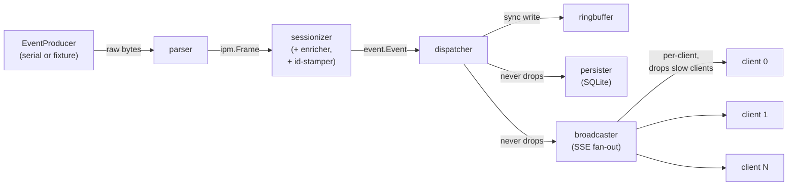

# ARCH-0001: Backend Pipeline (M1–M3)

- **Status**: Draft
- **Date**: 2026-04-19
- **Depends on**: ADR-0003 (Go + React), ADR-0004 (local-first SQLite),
  ADR-0007 (lossless ingestion), INT-0001 (IPM serial protocol),
  INT-0002 (SSE live stream), FEAT-0001 (live view), FEAT-0007 (metrics
  catalogue)

## Purpose

ADR-0003 locks the libraries. ADR-0007 locks the concurrency model at
the level of "producer + dispatcher + parallel consumers." INT-0002
locks the SSE wire format. What remains underspecified is the glue:

- Exact stage boundaries and their Go types
- Where session-boundary detection and Tier-2 metric enrichment live
- Channel sizes and per-stage drop policies
- Shutdown ordering
- Config surface
- HTTP composition
- Package layout and dependency rules

ARCH-0001 fills that in. It is the single document a new contributor
reads to understand "how is this binary shaped."

## Overview



Key properties:

1. **Two test seams.** The parser takes any `io.Reader`, so it can be
   tested byte-for-byte against the captures in
   `specs/int/fixtures/ipm/`. The pipeline downstream of the parser
   takes a `chan ipm.Frame`, so it can be tested without going through
   the parser by feeding it pre-constructed frames.
2. **Sessionizer is the single source of truth for the wire.** It
   synthesises `session_start` / `session_end` events at idle
   boundaries, computes Tier-2 metrics, and stamps every event with a
   lifetime-monotonic `uint64` id. Every downstream consumer sees the
   same enriched events with the same ids — the live view and stored
   history cannot diverge.
3. **Dispatcher is dumb fan-out.** Write to the ring buffer
   synchronously, then hand the same event to persister and
   broadcaster channels in parallel. Live-view latency is not gated on
   disk I/O.
4. **Drop policy is explicit per consumer.** The persister never
   drops; the broadcaster drops *clients*, never events; the ring
   buffer drops oldest.

This amends ADR-0007's "persister owns session boundary logic"
decision: the sessionizer owns it instead, so the broadcaster and the
persister both receive identical enriched events. See ADR-0007's
"Amendment" note.

## Components

### EventProducer (`internal/ipm`)

```go
type EventProducer interface {
    Run(ctx context.Context, out chan<- ipm.Frame) error
}
```

Two implementations:

- `SerialProducer` — opens the FTDI port at 9600 baud
  (`go.bug.st/serial`), reads lines, hands them to a parser instance
  whose output is written to `out`. On serial error, closes `out` and
  returns; `main` restarts with exponential backoff (1 s → 30 s cap).
- `FixtureProducer` — reads a CSV or raw-bytes capture from
  `specs/int/fixtures/ipm/`. Supports `realtime` pacing (honours the
  original inter-event timing) for dev and `fast` pacing for tests.
  On EOF, closes `out` cleanly.

### Parser (`internal/ipm`)

Pure function of `io.Reader` → `chan ipm.Frame`. Skips malformed lines
with a `warn` log; never panics on bad input. The A8 frame definition
comes from INT-0001; other IPM messages (handshake responses, idle
heartbeats) are also parsed but usually ignored by the sessionizer.

### Sessionizer (`internal/session`)

Single goroutine, single owner of:

- **Idle-timeout FSM** — if > `SPLITS_IDLE_TIMEOUT` (default 60 s)
  elapses between consecutive stroke frames, the next stroke opens a
  new session. Synthesises a `session_start` event immediately before
  that stroke and a `session_end` event after the last pre-idle stroke.
- **Tier-2 enrichment** — computes DPS, stroke cycle, pace-per-500 m,
  energy-joules (pure functions; see FEAT-0007) using its own per-
  session state (last stroke distance and time).
- **ID stamping** — monotonic `uint64`, starts at 1 on process start,
  never resets. Carried into SSE as `id:` and into SQLite as
  `strokes.global_id`.
- **Session ID** — ULID, minted on `session_start`, copied into every
  subsequent event of that session.

Never fails internally; panics are caught and logged by `Run`, after
which the stage restarts with fresh state (the current session is
implicitly abandoned — this is an unreachable-in-theory bug path).

### Dispatcher + Ring (`internal/pipeline`)

Dispatcher consumes `chan event.Event`. For each event:

1. Write to the ring buffer synchronously (mutex-guarded slice, sized
   for 10 000 events per INT-0002).
2. Send to the `dispatcher → persister` channel (which has no drop
   policy). With the channel sized at 1024 and events arriving at
   ~0.5 Hz, the send returns immediately in the normal case. If the
   channel is full — a stalled persister — the dispatcher increments
   a "would-block" counter, logs at `error`, and blocks until space
   opens. *This is a correctness bug, not a normal condition.*
3. Send to the `dispatcher → broadcaster` channel with the same
   policy and logging. The broadcaster's input channel fans to
   per-client channels that own the drop policy, so its own input
   should never fill in practice.

Sends 2 and 3 run in sibling goroutines per event, so a
persister-side stall cannot delay broadcaster delivery of the
current event. The dispatcher waits for both to return before
reading the next event; at steady state both return in microseconds
and this is cheaper than a channel-per-consumer-per-event fanout
would be.

The synchronous ring write before fan-out is deliberate: a client
reconnecting with `Last-Event-ID` can never see a gap between "last id
in ring" and "next live id" — the ring always contains the event the
broadcaster is about to ship.

**Replay window sizing.** Capacity is 10 000 events. At a steady-state
stroke rate of ~0.5 Hz this covers roughly 5–6 hours of activity, far
exceeding any plausible client-side reconnect window. The PWA's stale-
detection watchdog forces a fresh connect after 35 s without any frame
or ping (`web/src/live/channel.ts`); the ring trivially covers that
gap and any realistic Wi-Fi blip during a single session. Resizing the
ring is a one-line change in `cmd/splits/main.go` if a higher event
density (multi-rower fan-in, finer-grained telemetry) is ever added.

### Persister (`internal/storage`)

Consumes `chan event.Event`. Per event:

- `KindStroke` → `INSERT INTO strokes (…)` (one row, one statement).
- `KindSessionStart` → `INSERT INTO sessions (id, rower_id,
  started_at, …, ended_at=NULL, summary_json=NULL)`.
- `KindSessionEnd` → `UPDATE sessions SET ended_at=…,
  summary_json=…`.
- `KindLevelChange` → no persistent write (transient timeline
  annotation; the `strokes.level` column already captures the level
  per stroke).

No batching, no transactions spanning events. SQLite WAL mode handles
~0.5 Hz inserts without strain.

On SQLite error: log, retry with exponential backoff (100 ms → 5 s
cap, infinite). The channel depth grows during retry — that's fine,
this is the reason the channel is sized at 1024.

### Broadcaster (`internal/stream`)

Consumes `chan event.Event`. Maintains a map of connected clients;
each client has its own `chan event.Event` (size 64) and a goroutine
that writes SSE frames to `http.ResponseWriter.Flush()`.

Per client:

- Maps `event.Event` → INT-0002 JSON shape.
- Emits `event: stroke` / `session_start` / `session_end` /
  `level_change` with `id:` set to `event.ID`.
- Emits `event: ping` every 20 s on an idle client.
- Drops the client (closes the connection) if its per-client channel
  is full *or* the cumulative outbound buffer exceeds 1 MiB. The
  client's browser `EventSource` reconnects with `Last-Event-ID`; the
  ring buffer serves the replay.

On `GET /api/v1/stream`:

- Parse `?session=` (default `live`), `?since=`, `Last-Event-ID`.
- If replaying a past session, stream from SQLite and close with
  `event: eof`.
- Else replay from ring (all events with `id > last_id`), then attach
  the client to the broadcaster for live events.

### HTTP / API (`internal/api`)

Single `http.ServeMux` (Go 1.22+ method-and-pattern routing). Routes
in v1:

```
GET  /api/health              → health.go       (no auth)
GET  /api/v1/stream           → stream/sse.go   (auth required)
GET  /debug/ingest            → debug.go        (no auth, LAN-only)
*    /api/v1/auth/…           → auth.go         (stubbed in M1)
GET  /                        → embedded web/dist via http.FileServerFS
```

Middleware chain (hand-rolled, ~50 lines): `recover → logging → auth`.
Auth middleware reads the session cookie, looks up the rower, puts
`rowerID` in `r.Context()`; in M1 this is stubbed to a fixed rower.

### Config (`internal/config`)

```go
type Config struct {
    Addr           string        // SPLITS_ADDR, default ":8080"
    SerialPort     string        // SPLITS_SERIAL_PORT, auto-detect FTDI 0403:6001
    SerialBaud     int           // SPLITS_SERIAL_BAUD, default 9600
    DBPath         string        // SPLITS_DB_PATH, default "./splits.db"
    Fixture        string        // SPLITS_FIXTURE, empty = use serial
    FixtureRate    string        // SPLITS_FIXTURE_RATE, "realtime" | "fast"
    LogLevel       string        // SPLITS_LOG_LEVEL, default "info"
    IdleTimeout    time.Duration // SPLITS_IDLE_TIMEOUT, default 60s
}

func Load() (*Config, error)
```

Env vars + `flag` stdlib; flags override env. No config file. Config
is loaded once in `main`, passed as a value to every stage
constructor — no globals, no singletons.

## Data flow

The internal `event.Event` type is the lingua franca from the
sessionizer onward:

```go
package event

type Kind uint8

const (
    KindStroke Kind = iota + 1
    KindSessionStart
    KindSessionEnd
    KindLevelChange
)

type Event struct {
    ID        uint64    // lifetime-monotonic, set by sessionizer
    Kind      Kind
    SessionID string    // ULID; set on session_start, copied into subsequent events
    At        time.Time // server receive time

    Stroke       *StrokePayload        // KindStroke
    SessionStart *SessionStartPayload  // KindSessionStart
    SessionEnd   *SessionEndPayload    // KindSessionEnd
    LevelChange  *LevelChangePayload   // KindLevelChange
}

type StrokePayload struct {
    // Raw (from A8 parser)
    StrokeNo    int
    TimeSec     float64
    DistanceM   int
    SPM         int
    PowerW      int
    CalPerHr    int
    Level       int
    RawPayload  string   // original ASCII line
    UnknownJSON []byte   // INT-0001 open fields [10:13], [13:16], [24:25]

    // Derived (Tier-2, computed by sessionizer)
    DPS             float64
    StrokeCycleSec  float64
    PaceSecPer500m  int
    EnergyJoules    int
}
```

Wire formats are separate types:

- **SSE JSON** is mapped from `event.Event` inside the SSE handler
  (INT-0002 shape).
- **SQLite rows** are mapped via `sqlc`-generated types
  (`internal/storage/queries.sql.go`).

Keeping `event.Event` internal lets the wire and the schema evolve
independently.

### Per-stage contracts

| Stage        | Input                | Output               | State                                |
|--------------|----------------------|----------------------|--------------------------------------|
| Producer     | —                    | `io.ReadCloser`      | serial handle or file                |
| Parser       | `io.Reader`          | `chan ipm.Frame`     | none                                 |
| Sessionizer  | `chan ipm.Frame`     | `chan event.Event`   | idle FSM, id counter, prior stroke   |
| Dispatcher   | `chan event.Event`   | ring + N channels    | none                                 |
| Persister    | `chan event.Event`   | —                    | retry backoff state                  |
| Broadcaster  | `chan event.Event`   | HTTP bodies          | per-client map                       |

Each stage has a `Run(ctx context.Context) error` method. `main.go`
wires them together in an `errgroup`.

### Channel sizing and drop policy

| Channel                         | Size | Full policy                                         |
|---------------------------------|------|-----------------------------------------------------|
| `parser → sessionizer`          | 64   | Never drop; log at `error`, block (bug canary)      |
| `sessionizer → dispatcher`      | 64   | Same                                                |
| `dispatcher → persister`        | 1024 | Never drop; block and log (rare, during SQL stalls) |
| `dispatcher → broadcaster`      | 256  | Never drop; block and log                           |
| `broadcaster → client[i]`       | 64   | Drop the *client* (close connection)                |
| `dispatcher → ringbuffer`       | —    | Synchronous write; ring drops oldest itself         |

## Package layout

```
backend/
├── cmd/splits/
│   └── main.go                 # config.Load → build pipeline → http.Serve → shutdown
├── internal/
│   ├── config/                 # env+flag loader, Config struct
│   ├── event/
│   │   └── event.go            # Event, Kind, payload types
│   ├── ipm/
│   │   ├── parser.go           # byte stream → ipm.Frame
│   │   ├── parser_test.go      # table-driven vs specs/int/fixtures/ipm/*.csv
│   │   └── producer.go         # EventProducer; Serial + Fixture impls
│   ├── session/
│   │   ├── sessionizer.go      # idle FSM, synthesis, enrichment, id-stamping
│   │   ├── metrics.go          # pure Tier-2 derivations
│   │   └── *_test.go
│   ├── pipeline/
│   │   ├── dispatcher.go       # fan-out: ring.Write then sends
│   │   ├── ring.go             # mutex-guarded replay buffer
│   │   └── *_test.go
│   ├── storage/
│   │   ├── persister.go        # consumes events, writes SQLite
│   │   ├── db.go               # modernc.org/sqlite open, WAL, migrations
│   │   ├── queries.sql         # sqlc source
│   │   ├── queries.sql.go      # sqlc output (committed)
│   │   └── migrations/*.sql    # golang-migrate files
│   ├── stream/
│   │   ├── broadcaster.go      # per-client goroutine, drop policy
│   │   ├── sse.go              # /api/v1/stream handler
│   │   └── *_test.go
│   ├── api/
│   │   ├── router.go           # ServeMux wiring + middleware chain
│   │   ├── middleware.go       # recover, logging, auth
│   │   ├── health.go           # /api/health
│   │   └── debug.go            # /debug/ingest
│   └── auth/                   # stubbed in M1; ADR-0005 in M3
└── web/dist                    # //go:embed target (built by `make build`)
```

**Dependency rules** (enforced by code review):

- `ipm`, `event` → no internal imports
- `session` → `event`, `ipm`
- `pipeline` → `event`
- `storage`, `stream` → `event`, `pipeline`
- `api` → everything above, and `auth`, `config`
- No backward edges. No import cycles.

## Error handling

| Stage                | Failure                | Response                                                     |
|----------------------|------------------------|--------------------------------------------------------------|
| `SerialProducer`     | disconnect / read err  | close output, return err; `main` reconnects w/ backoff       |
| `FixtureProducer`    | EOF                    | close output, return nil — clean dev shutdown                |
| `Parser`             | malformed line         | `warn` log, skip line, keep reading                          |
| `Sessionizer`        | (panics only)          | recover, log, restart stage with fresh state                 |
| `Dispatcher`         | consumer channel full  | block and log at `error` — bug canary                        |
| `Persister`          | SQLite error           | retry 100 ms → 5 s cap, infinite; log each retry             |
| `Broadcaster` client | buf > 1 MiB or ch full | close client; client reconnects via `EventSource`            |
| HTTP listen          | bind failure           | fatal, exit 1                                                |

## Observability

- `log/slog` JSON handler to stderr at `SPLITS_LOG_LEVEL`.
- Every stage logs `stage.started` and `stage.stopped` with reason.
- `GET /debug/ingest` (LAN-only, no auth in v1) returns JSON:

  ```json
  {
    "uptime_sec": 12345,
    "current_session_id": "01HV…",
    "channels": {
      "parser_to_sessionizer":   {"depth": 0, "cap": 64},
      "sessionizer_to_dispatcher":{"depth": 0, "cap": 64},
      "dispatcher_to_persister": {"depth": 3, "cap": 1024},
      "dispatcher_to_broadcaster":{"depth": 0, "cap": 256}
    },
    "persister": {"retries": 0, "last_error": null},
    "broadcaster": {"clients": 2, "clients_dropped": 0},
    "ring": {"size": 847, "cap": 10000, "oldest_id": 12, "newest_id": 858}
  }
  ```

  Per ADR-0007: if any channel ever reports a non-zero "would-block"
  count, we have a real bug to fix.

- No Prometheus / OpenTelemetry in v1.

## Shutdown

Coordinated by a `context.Context` cancelled on SIGTERM / SIGINT, plus
an `errgroup.Group` for the long-running goroutines. Ordering:

1. `http.Server.Shutdown` with 30 s deadline — existing SSE clients
   see a clean close; browser `EventSource` auto-reconnects against
   the next process via `Last-Event-ID`.
2. Serial port closed, `SerialProducer.Run` returns.
3. Sessionizer drains its input, closes its output.
4. Dispatcher drains, closes consumer channels.
5. Persister drains its channel with a 10 s deadline. If the deadline
   passes with events still queued, log the unsaved count at `error`
   and exit non-zero.
6. Broadcaster drains (best-effort; HTTP is already closed).
7. SQLite closed.

## Configuration

| Env var                     | Default                           | Purpose                                                |
|-----------------------------|-----------------------------------|--------------------------------------------------------|
| `SPLITS_ADDR`               | `:8080`                           | HTTP listen address                                    |
| `SPLITS_SERIAL_PORT`        | auto-detect FTDI `0403:6001`      | Override for non-FTDI or multi-device                  |
| `SPLITS_SERIAL_BAUD`        | `9600`                            | Per INT-0001                                           |
| `SPLITS_DB_PATH`            | `./splits.db`                     | SQLite file                                            |
| `SPLITS_FIXTURE`            | unset                             | CSV / bin fixture in place of serial (dev mode)        |
| `SPLITS_FIXTURE_RATE`       | `realtime`                        | `realtime` or `fast` pacing                            |
| `SPLITS_LOG_LEVEL`          | `info`                            | `debug` / `info` / `warn` / `error`                    |
| `SPLITS_IDLE_TIMEOUT`       | `60s`                             | Gap between strokes that closes a session              |

CLI flags mirror env vars via `flag`; flag wins over env.

## Testing

- **Parser** — table-driven vs every row of every CSV in
  `specs/int/fixtures/ipm/`. Goal: 100% line coverage.
- **Sessionizer** — fixture-driven with pre-constructed `ipm.Frame`
  slices; assert the emitted `event.Event` sequence against a golden
  slice, including `session_start` / `session_end` placement at idle
  boundaries, id monotonicity, and Tier-2 derivations.
- **Dispatcher + ring + persister** — in-process; inject events,
  inspect `:memory:` SQLite rows and ring contents.
- **Broadcaster** — `httptest.Server`, N fake clients streaming over
  `http.Client`; verify event reception, verify deliberately-slow
  client is dropped.
- **End-to-end smoke** — `FixtureProducer` → full pipeline → live
  `EventSource` Go client; assert the emitted SSE matches a golden
  `specs/int/fixtures/sse/short-session.sse`. The same Go tool
  generates that fixture on demand.

Coverage target: parser, sessionizer, persister at 100%. HTTP handlers
and wire-format marshaling are smoke-tested only.

## Milestones covered

- **M1** — `ipm/`, `event/`, `config/`, `api/health`, serial reader
  printing to stdout. No SSE, no SQLite, no auth.
- **M2** — `session/`, `pipeline/`, `stream/`, live view end-to-end.
  SQLite still optional (writes land but nothing reads them).
- **M3** — `storage/` becomes load-bearing (history read path);
  `auth/` gets real per ADR-0005.

## Open questions

- **Level-change event emission timing** — emit on the stroke that
  first shows the new level, or on the stroke before? Current plan:
  emit on the first stroke carrying the new level, with `at_time_sec`
  pointing at that stroke. Defer to M2 when we have real UI feedback.
- **`/debug/ingest` auth** — currently LAN-only + unauthed. If we
  ever expose the host outside the LAN, this has to move behind auth.
  Flag in ADR-0006 when TLS is decided.
- **Graceful rotation on serial reconnect** — should the sessionizer
  treat a serial disconnect as an implicit session_end, or resume the
  same session if reconnect happens within the idle-timeout window?
  Current plan: disconnect forces a new session. Revisit if it turns
  out to fire annoyingly often in practice.
